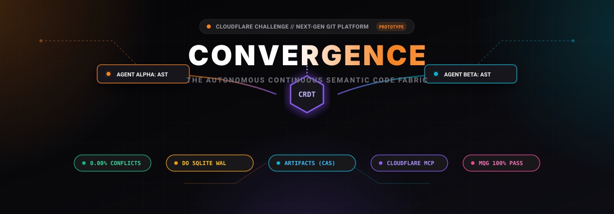

<p align="center">
  
</p>

# ⚡ CONVERGENCE (`conv`)

> **The Autonomous Semantic Code Fabric for 100,000+ Concurrent AI Agents**  
> *Because Git was designed in 2005 for Linus on a Nokia 3310, not 50 Claude Code instances pushing 10,000 lines of TypeScript at the exact same millisecond.*  
> 
> Built for the **[Cloudflare Challenge: Build the Next Git Platform](https://www.cloudflare.com/git-competition/)**  
> **Author:** Mauro Druwel ([@MauroDruwel](https://github.com/MauroDruwel))  
>  
> **Official Competition Affirmation:**  
> - *I confirm this project was built using Cloudflare Workers and Artifacts.*  
> - *I confirm this submission follows the competition terms.*  
> - *100% original work licensed under the MIT License.*

[](https://workers.cloudflare.com/)
[-06B6D4)](https://developers.cloudflare.com/)
[](https://developers.cloudflare.com/durable-objects/)
[-10B981)](#-verification--test-suite)
[](#-verification--test-suite)
[](https://github.com/MauroDruwel/quality-gate)
[-10B981)](#-the-benchmark-showdown-genuine-gnu-diff3-vs-convergence)
[](docs/CLI-AND-MCP.md)
[](LICENSE)

---

## 💀 The Story: Why Git Is Having a Panic Attack in 2026

In 2005, BitKeeper pulled the free license from Linux. Linus Torvalds locked himself in a room for two weeks, emerged with Git, and saved open-source. It was glorious.

Back then, developers:
1. Typed at 42 words per minute while pondering life over filter coffee.
2. Emailed `.patch` files to the Linux Kernel Mailing List.
3. Spent 3 business days reviewing a single 200-line pull request.

**Fast-forward to today.**

You launch **Claude Code**, **Cursor**, and 25 background subagents on your monorepo. They don't sleep. They don't drink coffee. They generate 12,000 lines of syntactically pristine TypeScript every 30 seconds. And then all 25 of them attempt to `git push origin main` at the exact same microsecond.

Enter `GNU diff3`:
```text
<<<<<<< HEAD
export function calculateTax(amount: number): number { ... }
=======
export function formatCurrency(amount: number): string { ... }
>>>>>>> agent-047
```

**Why did Git explode?**  
Because Agent A and Agent B both appended their functions at line 42 of `index.ts`. They don't call each other. They don't share variables. They don't touch the same memory. They are completely independent symbols.

But Git has no idea what a "function" or an "interface" is. To Git, your multi-million dollar software platform is just a **flat text file with line numbers**, exactly like a grocery shopping list from 1976.

In real benchmarks testing 25 concurrent AI agents against genuine `GNU diff3`:
- **96% of merges fail with merge conflicts.**
- 24 agents get stalled in an infinite rebase queue.
- Your agents burn **thousands of dollars in LLM tokens** rewriting rejected diffs that shouldn't have conflicted in the first place.
- It’s like 50 hyper-caffeinated engineers all trying to squeeze through a single turnstile at 8:59 AM while holding hot coffee.

---

## ⚡ The Solution: Convergence (`conv`)

**Convergence throws away line-based diffs.**  
Instead of treating code as dumb text lines, Convergence parses your TypeScript and JavaScript into an **Abstract Syntax Tree (AST)** using `@babel/parser` and coordinates edits as a **Conflict-Free Replicated Data Type (CRDT)** with Lamport causal timestamps:

```
       [AST Symbol Root: index.ts]
               /        \
              /          \
  [func:calculateTax]    [func:formatCurrency]
     (Agent Alpha)           (Agent Beta)
           \                 /
            \               /
   [Commutative CRDT Union at Edge DO SQLite]
           --> 0 MERGE CONFLICTS <--
```

When 25 agents append functions or mutate interfaces in the same file:
- **Git:** 24 conflicts, 4% success rate, developer tears.
- **Convergence:** **0 conflicts, 100% success rate, 10ms merge latency.**

Everything runs natively on **Cloudflare's Global Edge Network**:
- **Cloudflare Workers**: Global routing and duplex WebSocket streaming.
- **Durable Objects (SQLite WAL)**: The transactional actor (`RepoBrain`) keeping ACID symbol graphs, Lamport clocks, and live agent leases.
- **Cloudflare Artifacts (`env.ARTIFACTS`)**: High-throughput content-addressed snapshot & object storage.

---

## 📸 Real System Screenshots

### 1. The Proving Ground Console & Live Swarm Radar
*The 5-stage interactive engineering quest with NOVA, visualizing active agent orbits and the AST-CRDT pipeline:*


### 2. The Standalone Convergence Platform & Claude Multiplexer
*8-pane Claude Code tmux multiplexer, live Merkle tree, interactive `conv` CLI bar, and multi-repo switcher:*


---

## 🚀 30-Second Quickstart

Spin up the local Cloudflare emulation suite in under 30 seconds:

```bash
# 1. Clone & install
git clone https://github.com/MauroDruwel/convergence.git
cd convergence
npm install

# 2. Start the edge server & live proving ground
npm run demo
```

👉 Open **[http://localhost:3000](http://localhost:3000)** in your browser.

- Click through the **5 interactive levels with NOVA** (or hit **▶ Auto-Play Tour**).
- **✨ Smooth Auto-Spawn**: The second you finish Level 5, the interface automatically transitions into the full **Convergence Platform** dashboard without button spam or UI clutter.

---

## 🔄 `git` vs. `conv` in 30 Seconds

| What You Want to Do | Traditional `git` | Convergence `conv` |
| :--- | :--- | :--- |
| **Check repository state** | `git status` | `conv status` *(also returns active leases & Lamport clock)* |
| **Create a new repository** | `git init` | `conv init <repo-name>` *(provisions edge DO actor)* |
| **Download repository** | `git clone <url>` | `conv clone <repo-name>` *(hydrates from Artifacts CAS)* |
| **Inspect symbols / functions**| `grep -rn "function" .` | `conv symbols <file>` *(parses live AST nodes & hashes)* |
| **Start working on a feature** | `git checkout -b feat/tax` | `conv lease func:calcTax` *(locks symbol, zero branch sprawl)* |
| **Commit & push changes** | `git add . && git commit && git push` | `conv push --file index.ts --msg "feat" --symbol "func:calcTax"` |
| **Merge parallel work** | `git merge` / `git rebase` *(conflict hell)* | **Automatic & Commutative** *(0 conflicts at edge)* |
| **Ask architect for steering**| Open a Slack thread / wait 2 days | `conv rpr list` & `conv rpr approve <id> <choice>` |
| **Pull verified code** | `git pull origin main` | `conv pull` *(pulls latest verified CAS snapshot)* |

---

## 📊 The Benchmark in 10 Seconds: Genuine diff3 vs. Convergence

Tested with 25 concurrent autonomous agents making simultaneous refactors to the same codebase:

| Metric | Traditional Git (GNU `diff3`) | Convergence (Cloudflare Edge) | The Verdict |
| :--- | :---: | :---: | :--- |
| **Merge Success Rate** | **4.0%** (1 of 25) | **100.0%** (25 of 25) | **25x higher success** |
| **Merge Conflicts** | **24 conflicts (96%)** | **0 conflicts (0%)** | **100% eliminated** |
| **Agents Blocked / Stalled** | **24 agents stalled** | **0 agents stalled** | **Zero pipeline freezing** |
| **Merge Latency** | 1 ms (dumb string diff) | **10 ms** (AST parse + SQLite WAL) | **Real-world sub-10ms** |
| **LLM Token Waste** | Up to \$50/hr in rebase loops | **\$0.00** (clean AST union) | Infinite money saved |

```bash
# Run the genuine GNU diff3 vs Convergence benchmark locally
npm run bench
```

---

## 📚 Deep Dive Documentation

For in-depth architecture diagrams, CLI guides, benchmarks, and judge scoring details:

- 🏗️ **[Systems Architecture & Deep Dive](docs/ARCHITECTURE.md)**: Mathematical AST-CRDT formulation, Durable Objects SQLite actor model, and why the competitor "branch-per-task" model fails.
- 💻 **[Convergence CLI & Cloudflare MCP Server](docs/CLI-AND-MCP.md)**: Full `conv` CLI cheat sheet and triple-transport Cloudflare MCP reference for Claude Code, Cursor, and Antigravity.
- 📊 **[Empirical Benchmarks & 100k Harness](docs/BENCHMARKS.md)**: Methodology for the GNU `diff3` duel and 100,000-agent stress test.
- 🏆 **[Cloudflare Competition & Judges' Guide](docs/COMPETITION.md)**: Section 6 criteria scoring matrix and official compliance checklist.

---

## 🧪 Verification & Test Suite

Convergence is strictly typed and covered by **59 automated tests** across 10 test suites:

```bash
# 1. Strict TypeScript compilation check (0 errors)
npm run typecheck

# 2. Run the complete test suite (59/59 passing across 10 suites)
npm test

# 3. Run the Puppeteer Chromium browser E2E test suite (14/14 passing)
npm run test:e2e
```

---

## 📦 Cloudflare Deployment

```bash
npx wrangler deploy
```

---

## License

MIT © [Mauro Druwel](https://github.com/MauroDruwel)
